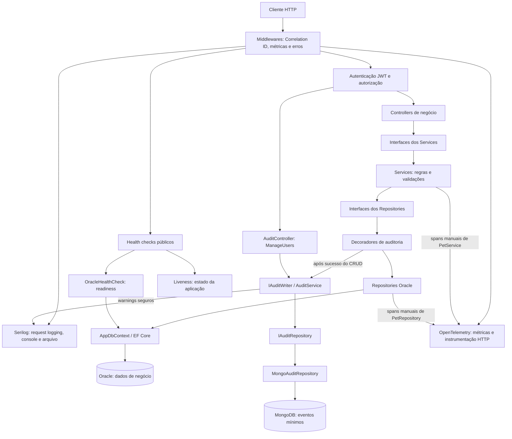

# GuardianPet

API REST em **ASP.NET Core 8** para organizar o atendimento de uma clínica veterinária. O GuardianPet permite cadastrar, consultar, atualizar e excluir usuários, pets, veterinários e consultas. O Oracle é o banco principal; o MongoDB armazena eventos mínimos de auditoria.

A Sprint 4 acrescenta interfaces dos Services, filtros combináveis, ordenação, paginação no banco, HATEOAS opcional e auditoria best-effort. As respostas anteriores são preservadas quando os novos parâmetros não são enviados.

Projeto acadêmico do curso de **Análise e Desenvolvimento de Sistemas da FIAP**, na disciplina **Advanced Business Development with .NET**.

## Integrantes

| Nome | RM | Turma |
|---|---|---|
| Yuri Fuzinatto Garzoli Barreto | 561450 | 2TDSPX |
| Nicolas de Oliveira Jacob | 564205 | 2TDSPX |
| Gabriel Ambrósio Saraiva | 566552 | 2TDSPV |
| Vinicius Romaguera Cardozo | 562308 | 2TDSPX |
| João Victor Vendrameto | 563665 | 2TDSPV |

Repositório: [GuardianPetV2 no GitHub](https://github.com/Yurifgb06/GuardianPetV2).

## Tecnologias

- C#, .NET 8 e ASP.NET Core Web API.
- Entity Framework Core 8 e Oracle.EntityFrameworkCore, com Oracle Database Free.
- MongoDB e o driver oficial MongoDB.Driver 3.12.0.
- JWT Bearer e PasswordHasher<User>.
- Swagger/OpenAPI e comentários XML.
- Serilog e OpenTelemetry.
- Docker e Docker Compose para execução local.
- xUnit, Moq e Microsoft.AspNetCore.Mvc.Testing.

## Arquitetura

O fluxo de negócio utiliza Controllers → interfaces dos Services → Services → interfaces dos Repositories → Repositories → EF Core → Oracle. A injeção de dependência seleciona as implementações concretas.

Os decoradores de auditoria implementam as mesmas interfaces dos repositórios. Eles delegam a operação ao repositório Oracle e, somente depois do sucesso, solicitam a gravação do evento no MongoDB. Os métodos de leitura apenas delegam a consulta. O GET administrativo utiliza AuditService diretamente; não substitui o fluxo dos dados de negócio.



A seta entre interface e implementação representa resolução por DI, e não uma camada adicional em execução. Os health checks são públicos e não passam pela exigência de JWT. O readiness consulta apenas o Oracle.

| Componente | Responsabilidade |
|---|---|
| Controllers | Receber HTTP, validar parâmetros e retornar os DTOs e códigos de resposta. |
| Interfaces e Services | Definir contratos específicos e concentrar regras de negócio. Há interfaces para os cinco Services, incluindo AuthService. |
| Interfaces e Repositories | Acessar o Oracle por meio do AppDbContext, aplicando filtros, ordenação e paginação antes da materialização. |
| DTOs | Separar entrada, saída e opções de consulta das entidades persistidas. |
| Presentation/Hateoas | Construir os links dos GET de negócio a partir das rotas reais e da requisição. |
| Audit | Decorar o CRUD, gravar/consultar eventos mínimos e apresentar os links da coleção administrativa. |
| Middlewares e Observability | Tratar erros, correlacionar requisições, gerar logs e coletar traces/métricas. |

A solução contém três projetos: a API na raiz, `GuardianPet.Tests.Unit` e `GuardianPet.Tests.Integration`. As pastas principais incluem Controllers, Services, Repositories, DTOs, Models, Data, Migrations, Security, Presentation, Audit, Documentation, HealthChecks, Middlewares e Observability. Não foi criado repositório genérico.

## Entidades e operações CRUD

- **User:** dados cadastrais e senha armazenada como hash; e-mail e CPF possuem restrições de unicidade.
- **Pet:** nome, espécie, raça, idade, peso e porte. O modelo possui relacionamento muitos-para-muitos com usuários.
- **Veterinarian:** nome, e-mail, CRMV, especialidade e telefone; e-mail e CRMV possuem restrições de unicidade.
- **Consultation:** data, sintomas, diagnóstico, tratamento, observações e status, vinculados a usuário, pet e veterinário.

A existência dos relacionamentos de consultas é validada pelo Service. O relacionamento de usuários e pets está no modelo; não há endpoint específico para administrá-lo.

## Autenticação e autorização

`POST /api/users` é público para cadastro; `POST /api/auth/login` recebe `email` e `password`. No sucesso, retorna `token`, `expiration` em UTC e `userId`. Credenciais inválidas retornam 401.

As senhas são protegidas por `PasswordHasher<User>`. Senhas legadas em texto puro não são aceitas e precisam ser redefinidas. O JWT usa HS256 e valida assinatura, algoritmo, emissor, audiência e expiração. A validade padrão é de 60 minutos, com tolerância de relógio de 30 segundos.

Nos endpoints protegidos, envie o token obtido no login:

```http
Authorization: Bearer <TOKEN_OBTIDO_NO_LOGIN>
```

A política `ManageUsers` exige a claim `permission=users.manage`. Ela protege os GET, PUT e DELETE de usuários e o GET de auditoria. Pets, veterinários e consultas exigem JWT, sem autorização por proprietário nesta versão.

A lista `Jwt:AdminUserIds` é configurada pelo operador; o primeiro cadastro não recebe privilégios automaticamente. Para execução no host, use `Jwt__AdminUserIds__0` com o ID real da conta e faça login novamente. No Compose, essa variável precisa ser encaminhada à API por um override local: adicioná-la ao .env, sozinho, não faz esse encaminhamento.

Swagger, cadastro, login e health checks são públicos. Não há refresh token nem revogação de JWT. Veja [AUTHENTICATION.md](AUTHENTICATION.md), documento histórico da Sprint 3; os totais atuais de testes estão neste README.

## Grupos de endpoints

| Grupo | Método | Rota | Acesso |
|---|---|---|---|
| Auth | POST | `/api/auth/login` | Público |
| Users | POST | `/api/users` | Público |
| Users | GET | `/api/users`, `/api/users/search?name=...`, `/api/users/email?email=...` | ManageUsers |
| Users | GET / PUT / DELETE | `/api/users/{id}` | ManageUsers |
| Pets | POST / GET | `/api/pets` | JWT |
| Pets | GET / PUT / DELETE | `/api/pets/{id}` | JWT |
| Pets | GET | `/api/pets/search?species=...&petSize=...` | JWT |
| Veterinarians | POST / GET | `/api/veterinarians` | JWT |
| Veterinarians | GET / PUT / DELETE | `/api/veterinarians/{id}` | JWT |
| Veterinarians | GET | `/api/veterinarians/search/name?name=...`, `/api/veterinarians/search/specialty?specialty=...` | JWT |
| Consultations | POST / GET | `/api/consultations` | JWT |
| Consultations | GET / PUT / DELETE | `/api/consultations/{id}` | JWT |
| Audit | GET | `/api/audit-events` | ManageUsers |
| Health | GET | `/health`, `/health/ready` | Público |

POST bem-sucedido retorna 201 e Location; PUT retorna 200; DELETE retorna 204. Consultas retornam 200; dados inválidos, 400; falta de autenticação, 401; falta de permissão, 403; recurso inexistente, 404. Erros inesperados retornam 500 com mensagem genérica. Readiness e consulta de auditoria podem retornar 503.

Não existem GET individual de eventos de auditoria nem endpoints de escrita pública para auditoria. Campos obrigatórios, enums e schemas estão no Swagger.

## Paginação, ordenação e filtros

Os oito GET de coleções de negócio aceitam `page`, `pageSize`, `sortBy` e `sortDirection`. As rotas de busca mantêm seus parâmetros anteriores. GET por ID e `/api/users/email` continuam retornando um recurso individual.

| Parâmetro | Comportamento |
|---|---|
| `page` | Inteiro a partir de 1. Se apenas pageSize for informado, assume 1. |
| `pageSize` | Inteiro de 1 a 100. Se apenas page for informado, assume 20. |
| `sortBy` | Somente campos da lista abaixo; nomes aceitos sem diferenciar maiúsculas/minúsculas. |
| `sortDirection` | asc (padrão) ou desc; também aceita variações de maiúsculas/minúsculas. |

Sem page/pageSize, a coleção não é paginada. Com paginação, a ordem padrão é ID ascendente. Se somente sortDirection for informado, o campo é ID. Ordenações explícitas usam ID ascendente como desempate, inclusive quando o campo principal está em ordem descendente. Filtros, ordenação e Skip/Take são aplicados no Oracle antes de ToListAsync. Parâmetros inválidos retornam 400; deslocamentos acima de int.MaxValue também são rejeitados.

| Coleção | Filtros disponíveis | sortBy permitido |
|---|---|---|
| Users | name parcial e email exato, ambos sem diferenciar maiúsculas/minúsculas | id, name, email, phone |
| Pets | species parcial sem diferenciar maiúsculas/minúsculas; petSize exato | id, name, species, breed, age, weight, petSize |
| Veterinarians | name parcial sem diferenciar maiúsculas/minúsculas; specialty exata | id, name, email, crmv, specialty, phone, yearsExperience |
| Consultations | status, userId, petId, veterinarianId, dateFrom e dateTo | id, consultationDate, status, userId, petId, veterinarianId |

Em `/api/users/search` e `/api/veterinarians/search/name`, name continua obrigatório. A rota `/api/users/email` procura um usuário por email e retorna objeto ou 404; na coleção `/api/users?email=...`, o resultado é um array, possivelmente vazio.

Porte: SMALL, MEDIUM, BIG ou GIANT. Especialidades: CLINICA_GERAL, CIRURGIA, DERMATOLOGIA, CARDIOLOGIA, ORTOPEDIA, EMERGENCIA, DIAGNOSTICO_POR_IMAGEM.
Status de consulta: SCHEDULED, IN_PROGRESS, COMPLETED ou CANCELED. Os limites dateFrom/dateTo são data/hora inclusiva; dateTo não pode preceder dateFrom. Não há filtro por sintomas, diagnóstico ou tratamento.

Exemplos de requisições, com valores ilustrativos:

```http
GET /api/pets
GET /api/pets?species=Dog&petSize=SMALL&page=2&pageSize=10&sortBy=name&sortDirection=asc
GET /api/users?name=Ana&email=ana%40example.test&pageSize=10&sortBy=email
GET /api/veterinarians/search/specialty?specialty=CLINICA_GERAL&name=Ana&page=1&pageSize=5&sortBy=yearsExperience&sortDirection=desc
GET /api/consultations?petId=7&status=SCHEDULED&dateFrom=2026-10-01T00:00:00&dateTo=2026-10-31T23:59:59&sortBy=consultationDate&pageSize=20
```

Sem includeLinks, uma listagem continua sendo um array JSON direto, inclusive quando paginada. Uma busca sem correspondências retorna `[]`. Não são adicionados envelope, totalizadores ou links automaticamente.

## HATEOAS opcional

`includeLinks=true` ativa a representação com links nos GET de recursos e coleções. Ausente ou false, preserva exatamente o formato anterior, os DTOs, os enums, os códigos HTTP e a autorização. As respostas de erro não recebem links.

Exemplo de recurso, com dados fictícios:

```json
{
  "data": {
    "id": 7,
    "name": "Lua",
    "species": "Dog",
    "breed": "Labrador",
    "ageType": "ANOS",
    "age": 3,
    "weight": 20,
    "petSize": "MEDIUM"
  },
  "links": [
    {"rel": "self", "href": "https://api.example.test/guardian/api/pets/7?includeLinks=true", "method": "GET"},
    {"rel": "collection", "href": "https://api.example.test/guardian/api/pets?includeLinks=true", "method": "GET"}
  ]
}
```

Uma coleção sem paginação usa items/links. Cada item contém data e um link self para o GET por ID. Exemplo fictício de uma coleção sem correspondências:

```json
{
  "items": [],
  "links": [
    {"rel": "self", "href": "https://api.example.test/guardian/api/pets?species=ausente&includeLinks=true", "method": "GET"}
  ]
}
```

Em coleções paginadas, os links incluem self, first e last; prev aparece quando page > 1 e next quando há página seguinte. Os links preservam filtros, sortBy, sortDirection, pageSize e includeLinks, alterando page conforme a navegação. COUNT é executado no banco somente no modo HATEOAS paginado.

```http
GET /api/pets?species=Dog&sortBy=name&sortDirection=asc&page=2&pageSize=10&includeLinks=true
```

Os endereços acima apenas ilustram o formato. A aplicação gera URLs pelas rotas reais, usando esquema, host e PathBase da requisição, sem host fixo. Só são expostos links GET autorizados; não há links artificiais de escrita. Health checks mantêm sua resposta de texto.

## Oracle, EF Core e migrations

O Oracle Database Free usa porta local 1521 e PDB FREEPDB1. Dentro do Compose, a API acessa o serviço oracle-db; quando executada no host, usa a conexão local configurada pelo operador. O volume oracle-data mantém os dados.

As entidades e relacionamentos são mapeados pelo [AppDbContext](Data/AppDbContext.cs). A migration existente está em [Migrations](Migrations); nenhuma migration foi criada ou modificada na Sprint 4.

A API aplica as migrations existentes na inicialização antes de atender requisições, com tentativas enquanto o Oracle inicializa. Assim, iniciar a API pode alterar o schema apontado na configuração; para demonstração e testes, utilize apenas a base local adequada. Não remover volumes para resolver problemas de conexão.

## MongoDB e auditoria

O MongoDB complementa o Oracle. Os decoradores de User, Pet, Veterinarian e Consultation registram Created, Updated ou Deleted depois do método Oracle concluir com sucesso. Leituras e operações Oracle que falham não geram eventos.

Cada documento contém somente id, entityType, entityId, action, occurredAtUtc e correlationId. O ID é armazenado como _id/ObjectId no MongoDB e apresentado como id no JSON. Não são armazenados senhas, tokens, CPF, email ou conteúdo médico. O correlationId é o mesmo validado/gerado no middleware da requisição.

A auditoria é **best-effort**, sem garantia transacional conjunta, outbox ou recuperação automática de eventos perdidos. Falha do MongoDB não desfaz a operação confirmada no Oracle: gera um warning seguro e preserva a resposta do CRUD. O timeout padrão é de 1000 ms, configurável entre 100 e 10000 ms.

### Consulta administrativa

```http
GET /api/audit-events?entityType=Pet&entityId=7&action=Updated&page=1&pageSize=20
GET /api/audit-events?correlationId=demo-request&fromUtc=2026-10-01T00:00:00Z&toUtc=2026-10-31T23:59:59Z
```

Exige JWT e ManageUsers. Filtros exatos: entityType (User/Pet/Veterinarian/Consultation), entityId, action (Created/Updated/Deleted) e correlationId. fromUtc/toUtc delimitam data/hora UTC inclusiva; use ISO 8601 com Z. Page começa em 1, pageSize é 1..100, com padrões 1/20. A ordem fixa é occurredAtUtc e id descendentes; não há sortBy/sortDirection nesse endpoint.

Sem includeLinks retorna array. Com includeLinks=true retorna items/links e executa COUNT no MongoDB para navegação. Os itens de auditoria não têm links individuais, pois essa rota não existe. A consulta retorna 503 genérico quando o MongoDB está indisponível.

Veja [docs/mongodb-audit.md](docs/mongodb-audit.md) para os detalhes de configuração e isolamento.

## Health checks e observabilidade

| Recurso | Funcionamento |
|---|---|
| GET /health | Liveness público: 200 Healthy sem consultar banco. |
| GET /health/ready | Readiness público: testa Oracle por Database.CanConnectAsync; retorna 200 Healthy ou 503 Unhealthy. MongoDB não participa desta verificação. |
| Serilog | Logs JSON no console e em arquivo diário logs/guardianpet-.log, com retenção de 14 arquivos. |
| Correlation ID | Aceita X-Correlation-ID válido (até 128 caracteres ASCII alfanuméricos, ponto, hífen ou sublinhado); caso contrário, gera GUID. Inclui o ID nos logs, na resposta e nos eventos de auditoria. |
| OpenTelemetry | Instrumentação de ASP.NET Core e HttpClient; spans manuais em PetService/PetRepository. O acesso EF/Oracle fica dentro do span do repositório, sem instrumentação SQL dedicada. |
| Métricas | guardianpet.http.request.duration: histograma em ms; guardianpet.http.errors: respostas 400..599. Tags por método, status e padrão da rota, evitando séries por ID. |

Em Development, traces e métricas são exportados para o console; o intervalo de métricas é de 30 segundos. Não há coletor OTLP, painel externo nem spans manuais em todos os Services.

A aplicação não grava corpos de requisição, senhas ou tokens deliberadamente nos logs. Não envie credenciais em URLs nem nos exemplos de documentação. O endpoint de email deve ser demonstrado com dados fictícios.

## Execução local

É necessário Docker Desktop com engine Linux e Docker Compose. Para executar a API/testes no host, instale SDK compatível com net8.0 **e os runtimes .NET/ASP.NET Core 8**; apenas ter o SDK mais recente não garante esses runtimes.

### API no host, bancos no Docker

```powershell
docker compose up -d oracle-db
docker compose --profile local-audit up -d --no-deps mongodb
dotnet restore GuardianPet.sln
dotnet build GuardianPet.sln
dotnet run --project GuardianPet.csproj --launch-profile http
```

Aguarde o Oracle ficar pronto. O perfil http usa Development e [Swagger em localhost:5202](http://localhost:5202/swagger). O perfil https oferece [localhost:7143](https://localhost:7143/swagger), conforme launchSettings.json.

### API e bancos no Compose

```powershell
docker compose --profile local-audit up -d --build
docker compose --profile local-audit ps
docker compose logs --tail=100 guardianpet-api
```

O perfil inicia guardianpet-api, oracle-db e guardianpet-mongodb. A API usa porta 8080; o MongoDB local publica somente 127.0.0.1:27017 e tem volume próprio mongo-audit-data. Esse serviço local não exige autenticação e não define configuração de produção.

Acessos: [Swagger](http://localhost:8080/swagger), [liveness](http://localhost:8080/health), [readiness](http://localhost:8080/health/ready) e [OpenAPI JSON](http://localhost:8080/swagger/v1/swagger.json). No Swagger, faça login, selecione Authorize e informe apenas o token no esquema Bearer.

`docker compose up -d --build` sem o perfil não inicia MongoDB. Nesse caso, o CRUD Oracle continua funcionando, mas a auditoria pode falhar e a consulta administrativa retornar 503. Não usar remoção de volumes como parte da execução normal.

### Configuração segura

O [.env.example](.env.example) contém placeholders e valores locais sem credenciais reais. Antes de copiar para .env, substitua os placeholders por valores privados adequados. .env e arquivos privados estão ignorados pelo Git.

| Configuração | Finalidade |
|---|---|
| ASPNETCORE_ENVIRONMENT | Ambiente; use Development para a execução acadêmica local. |
| ORACLE_PASSWORD, APP_USER, APP_USER_PASSWORD | Inicialização de volumes Oracle novos; não alteram senhas de volumes existentes. |
| ConnectionStrings__OracleConnection | Conexão Oracle privada, configurada fora do versionamento. |
| Jwt__Key | Segredo de assinatura com pelo menos 32 bytes; não é uma chave assimétrica. |
| Jwt__Issuer, Jwt__Audience, Jwt__ExpirationMinutes | Emissor, audiência e validade. |
| Jwt__AdminUserIds__0 | ID real de uma conta administrativa configurada pelo operador. |
| MongoDB__ConnectionString, MongoDB__DatabaseName | Conexão MongoDB e database; padrões locais, sem dados de produção. |
| MongoDB__CollectionName, MongoDB__TimeoutMilliseconds | Coleção e timeout; padrões audit_events e 1000 ms. |

O Compose carrega .env para interpolação e encaminha somente as variáveis declaradas em seu environment. Para opções adicionais, é necessário um override local. A API iniciada por dotnet não carrega .env automaticamente: use variáveis exportadas no processo ou configuração privada existente. Nenhuma configuração funcional foi alterada nesta etapa de documentação.

As configurações de desenvolvimento já existentes têm defaults públicos e não devem ser reutilizadas em ambientes compartilhados. Fora de Development, a chave JWT pública de desenvolvimento é recusada. Nunca versionar credenciais, tokens ou connection strings privadas.

## Testes e validação

Os testes unitários usam xUnit/Moq e cobrem Services, consultas, compatibilidade, HATEOAS e auditoria. A integração usa WebApplicationFactory, fixtures e bancos reais.

A fixture Oracle cria schema GPTEST_* exclusivo, aplica a migration existente e remove somente esse schema ao terminar. A fábrica HTTP também usa database MongoDB GPTEST_<guid> exclusiva, com limpeza validada pelo nome. Não são usadas coleções de produção.

Os testes reais de MongoDB são ignorados quando o serviço não responde ao ping. Para reproduzir a validação completa, inicie ambos os bancos. Docker precisa estar acessível à fixture, que usa sqlplus no container Oracle.

```powershell
docker compose up -d oracle-db
docker compose --profile local-audit up -d --no-deps mongodb
dotnet build GuardianPet.sln
dotnet test GuardianPet.sln
git diff --check
```

Para somente os unitários: `dotnet test GuardianPet.Tests.Unit/GuardianPet.Tests.Unit.csproj`.

A integração cobre CRUD, login, autorização, respostas de erro, filtros/paginação/ordenação, links e PathBase, health checks, Swagger e auditoria real. A falha MongoDB é simulada com um cliente de teste apontando para uma porta sem serviço; a falha de repositório para 500 usa substituição somente no host de testes.

Validação da Sprint 4 em **12/10/2026**:

| Suíte | Aprovados | Falhas | Ignorados |
|---|---:|---:|---:|
| Unitários | 149 | 0 | 0 |
| Integração | 189 | 0 | 0 |
| **Total** | **338** | **0** | **0** |

Build com **0 erros e 0 avisos**. Esses resultados são de execução local; não representam cobertura percentual nem validação em Azure. Foram preservados os testes das etapas anteriores.

## Checklist acadêmico e limites de escopo

A matriz com requisitos, evidências e situações está em [docs/sprint4-checklist.md](docs/sprint4-checklist.md). Ela usa os critérios informados para esta Sprint; a rubrica oficial da disciplina não está no repositório e deve ser conferida antes da entrega.

Pontos para considerar na avaliação: HATEOAS é opcional por includeLinks=true para preservar clientes antigos; readiness verifica Oracle, sem MongoDB; tracing manual é demonstrado no fluxo de Pets; auditoria é best-effort. Não há refresh token, revogação de JWT ou autorização por proprietário.

Dockerfile, Compose e health checks fornecem uma base local para o trabalho de infraestrutura. Azure, ACR/ACI, pipelines, CI/CD e deploy pertencem ao colega de DevOps e não foram implementados nesta etapa. Não há alegação de publicação em nuvem.
